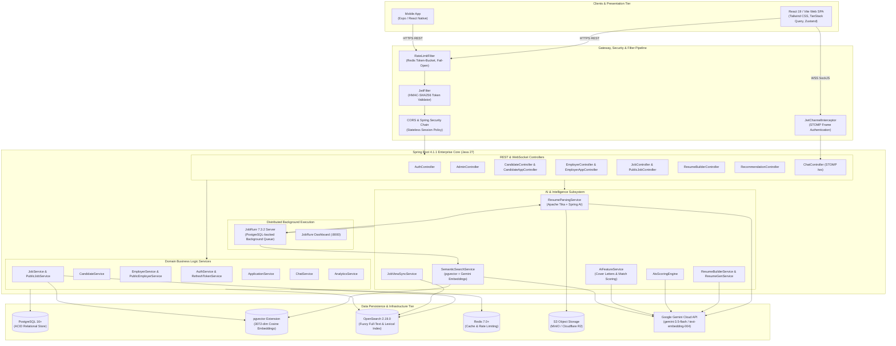
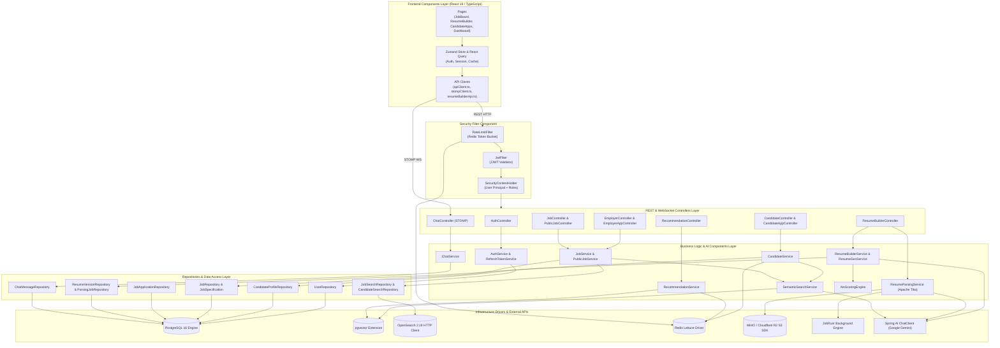
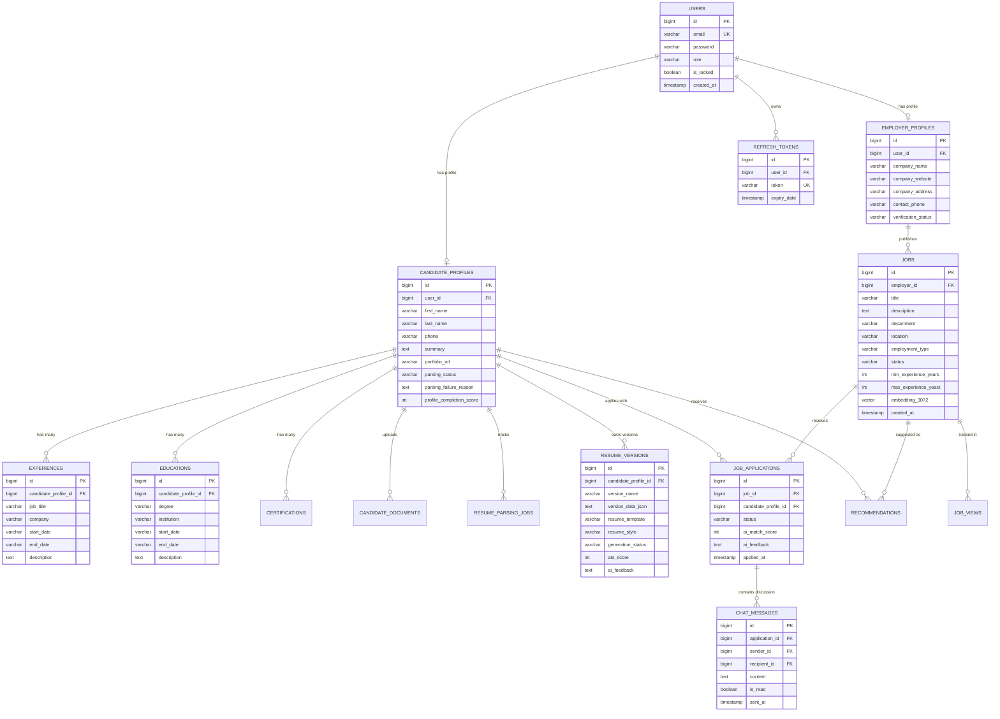
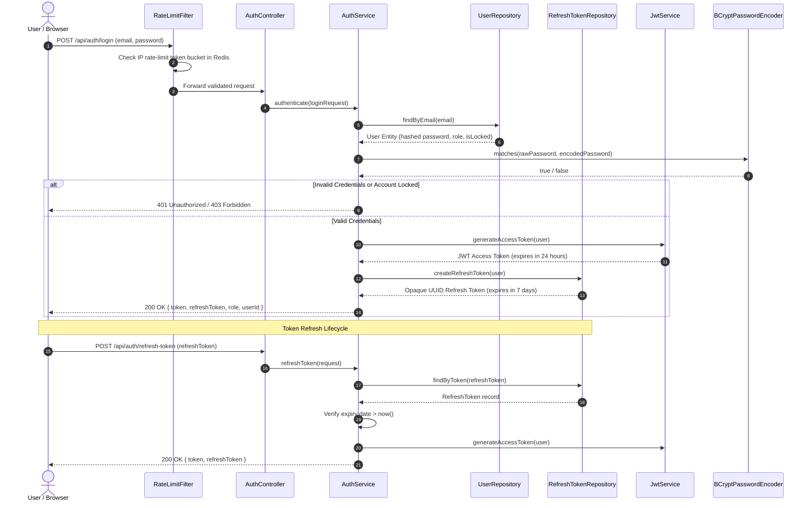
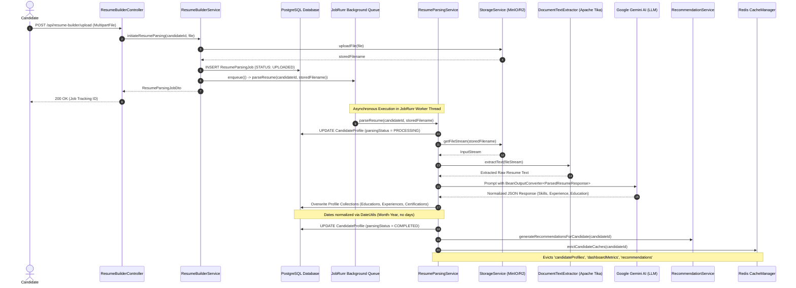
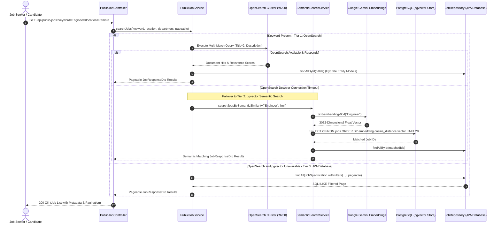
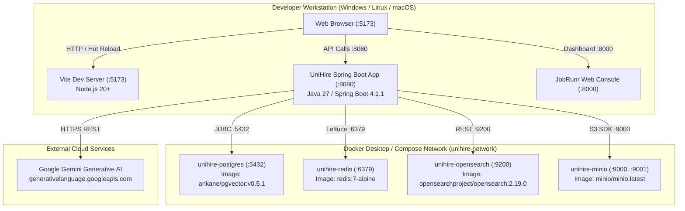
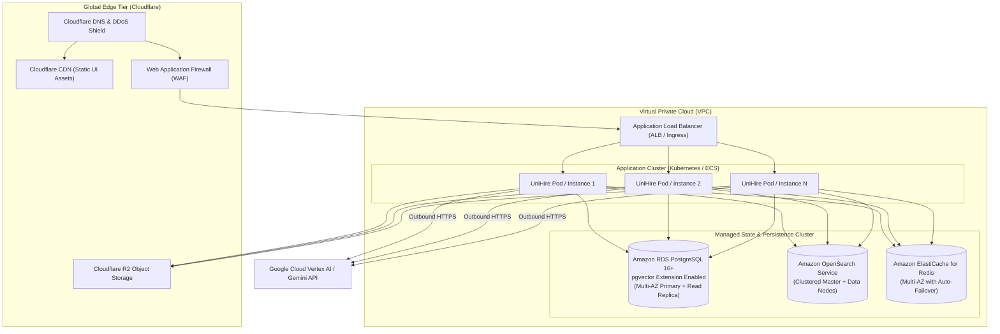

# UniHire Software Architecture Document (`ARCHITECTURE.md`)

This document provides a comprehensive technical architecture specification for the **UniHire** recruitment and talent acquisition platform. Every module, package, service, entity, API endpoint, background worker, caching mechanism, and communication flow documented herein directly corresponds to the source code implementation across the Spring Boot backend (`uniHire`) and React/Vite frontend (`uniHire-ui`).

---

## 1. System Context & High-Level Architecture

UniHire is structured as an enterprise AI-enhanced hiring platform. It supports three distinct tenant roles: **Candidate**, **Employer**, and **System Administrator**, orchestrating complex workflows such as asynchronous AI resume parsing, ATS scoring, vector-based semantic candidate-job matching, fuzzy full-text search, and real-time chat.

### 1.1 High-Level Architecture Diagram



---

## 2. Component Architecture & Package Decomposition

### 2.1 Backend Package Layout (`com.unihire`)

| Package | Key Classes | Core Responsibilities |
| :--- | :--- | :--- |
| **`config`** | `SecurityConfig`, `JwtFilter`, `RateLimitFilter`, `OpenSearchConfig`, `RedisCacheConfig`, `JobRunrConfig`, `WebSocketConfig`, `AdminDataInitializer`, `DatabaseCleanupConfig` | Configures Spring Security, stateless JWT auth, CORS, Redis caching fallback, JobRunr storage, OpenSearch HTTP client with SSL bypass, and WebSocket STOMP brokers. |
| **`controllers`** | `AuthController`, `CandidateController`, `EmployerController`, `JobController`, `PublicJobController`, `ResumeBuilderController`, `RecommendationController`, `ChatController`, `AdminController`, `AiFeatureController` | Exposes REST APIs, manages HTTP status codes (200, 201, 202, 204), extracts `@AuthenticationPrincipal User`, validates payloads via `@Valid`, and routes STOMP frames. |
| **`services`** | `AuthService`, `CandidateService`, `EmployerService`, `JobService`, `PublicJobService`, `ResumeBuilderService`, `ResumeParsingService`, `RecommendationService`, `ChatService`, `AiFeatureService`, `SemanticSearchService` | Encapsulates transactional business logic, cache annotations (`@Cacheable`, `@CacheEvict`), domain validations, and coordination between search/AI providers. |
| **`services.ai`** | `ResumeGenerationProvider`, `GeminiResumeGenerationProvider`, `MockResumeGenerationProvider` | Provides pluggable AI strategies for resume bullet point rewriting and executive summary tailoring using Gemini ChatClient. |
| **`services.extractor`**| `DocumentTextExtractor` | Ingests multipart files (PDF, DOCX) and parses raw textual streams using Apache Tika. |
| **`opensearch`** | `JobDocument`, `JobSearchRepository`, `CandidateDocument`, `CandidateSearchRepository` | Maps domain models to OpenSearch indices, executing multi-match fuzzy queries and aggregations. |
| **`models`** | `User`, `CandidateProfile`, `EmployerProfile`, `Job`, `JobApplication`, `Experience`, `Education`, `Certification`, `ResumeVersion`, `ResumeParsingJob`, `ChatMessage`, `Recommendation` | JPA entity models decorated with Hibernate annotations, lifecycle listeners, and enumerated states (`Role`, `JobStatus`, `ApplicationStatus`). |
| **`repositories`** | `UserRepository`, `CandidateProfileRepository`, `JobRepository`, `JobApplicationRepository`, `ResumeVersionRepository`, `ChatMessageRepository`, `JobSpecification` | Spring Data JPA interfaces providing declarative CRUD, pagination, and dynamic query filtering via JPA Criteria Specifications. |
| **`dto`** | `AuthResponse`, `LoginRequest`, `JobRequestDto`, `JobResponseDto`, `ResumeVersionDataDto`, `TargetCustomizationRequest`, `ParsedResumeResponse`, `AtsScoreDto` | Strongly-typed Data Transfer Objects preventing entity over-exposure and validating inputs. |
| **`utils`** | `DateUtils` | Enforces consistent `Month-Year` format (`Sept-2026 - Present`) across all AI-generated dates, parsing ISO, numeric, and text formats. |
| **`exceptions`** | `GlobalExceptionHandler`, `BadRequestException`, `ResourceNotFoundException`, `UnauthorizedOperationException` | Centralized `@RestControllerAdvice` converting application exceptions into standard RFC 7807 JSON error responses. |

### 2.2 Component Architecture Diagram

The component diagram below visualizes the internal structural relationships, package dependencies, and data tier interactions of the UniHire system:



### 2.3 Frontend Architecture (`uniHire-ui`)

The frontend application (`C:\reactProject\uniHire-frontEnd\apps\uniHire-ui`) is structured as a client-side single-page application:
- **State & Network Layer**:
  - `src/services/apiClient.ts`: Axios instance configured with base URL `/api`, authorization interceptors attaching JWT Bearer tokens from `localStorage`, and response interceptors handling 401 unauthenticated redirects.
  - `src/services/stompClient.ts`: Manages STOMP over SockJS client lifecycle, subscription mappings, and message frame dispatch.
  - `src/store/`: Zustand stores for user session, active application contexts, and transient state.
- **API Clients**:
  - `src/api/resumeBuilderApi.ts`: Client for resume compilation, generation polling, file upload, and document downloading.
  - `src/api/recommendationApi.ts`: Queries candidate and job recommendation feeds.
  - `src/api/admin.ts`: Administrative endpoints for user management and lock status toggling.
- **Resume Preview Rendering Engine**:
  - `src/components/candidate/ResumePreviewRenderer.tsx`: Pure HTML5 client-side rendering engine implementing 8 specialized ATS templates (`ATS_MODERN`, `CORPORATE`, `MINIMAL`, `EXECUTIVE`, `CREATIVE`, `ACADEMIC`, `TECH_STARTUP`, `MODERN_SPLIT`).

---

## 3. Microservices & Subsystem Communication

Although packaged as a modular monolith in Spring Boot for atomic transactions and simplified deployment, UniHire is engineered as distinct decoupled subsystems communicating over well-defined boundaries:

```mermaid
graph LR
    subgraph REST_Gateway["REST / HTTP Transport"]
        FE["Frontend (React UI)"] -->|JSON API Requests| HTTP_SRV["HTTP Dispatcher"]
    end

    subgraph RealTime["Real-Time Transport"]
        FE -->|STOMP over SockJS| WS_EP["/ws Endpoint"]
        WS_EP --> INTR["JwtChannelInterceptor"]
        INTR --> BROKER["In-Memory Message Broker"]
        BROKER -->|/topic/chat/{appId}| FE
    end

    subgraph AsyncBus["Asynchronous Background Queue (JobRunr)"]
        CORE["Core Business Services"] -->|Enqueue Job Lambda| JR_QUEUE[("PostgreSQL JobRunr Queue")]
        JR_QUEUE -->|Poll & Lease Lock| JR_WORKER["JobRunr Background Worker"]
        JR_WORKER --> AI_PARSE["ResumeParsingService"]
        JR_WORKER --> AI_REC["RecommendationService"]
    end

    subgraph ExtIntegrations["External Third-Party APIs"]
        JR_WORKER -->|HTTPS REST| S3_API["Object Storage (MinIO / R2)"]
        JR_WORKER -->|HTTPS REST| GEMINI_API["Google Gemini API (Chat & Embedding)"]
        CORE -->|HTTPS REST / HTTP5| OS_API["OpenSearch REST Engine (:9200)"]
    end
```

### 3.1 Inter-Subsystem Communication Rules
1. **Synchronous HTTP**: Used for user authentication, CRUD operations on jobs/profiles, and fetching dashboard summaries where immediate data consistency is mandatory.
2. **Asynchronous Polling Pattern**: Used for long-running AI operations (resume parsing, ATS scoring, resume customization). The client receives a `202 Accepted` status with a Job ID, and background workers process the task via JobRunr while the client polls `/api/resume-builder/versions/{id}` or checks parsing job status.
3. **STOMP Pub-Sub**: Used exclusively for candidate-employer chat messaging to deliver updates without client-side polling.
4. **Cache Invalidation Coupling**: State mutations in `CandidateService` trigger explicit cache evictions across `@CacheEvict(value = "candidateProfiles")`, `@CacheEvict(value = "dashboardMetrics")`, and `@CacheEvict(value = "recommendations")`. In background worker threads (JobRunr), caches are evicted programmatically via `CacheManager` to bypass Spring AOP proxy limitations.

---

## 4. Database Architecture & Entity Relationships

The relational persistence tier is hosted on PostgreSQL 16+ and extended with `pgvector` for vector storage.

### 4.1 Database Entity-Relationship (ER) Diagram



---

## 5. Security & Authentication Flows

UniHire implements a stateless authentication model backed by Spring Security, JJWT, and BCrypt.

### 5.1 Authentication & Token Refresh Flow



### 5.2 Authorization Rules (`SecurityConfig.java`)
- **Public Endpoints (`permitAll`)**:
  - `/api/auth/**`: Login, registration, token refresh, OTP sending/verifying, password resets.
  - `/api/public/**`: Public job boards, job detail views, verified employer public profiles.
  - `/ws/**`: WebSocket initial handshake and SockJS info queries.
  - `/api/ai/test`: Development sanity check endpoints.
- **Admin Endpoints (`hasRole('ADMIN')`)**:
  - `/api/admin/**`: System-wide metrics, candidate locking/unlocking, employer verification approvals.
- **Authenticated Endpoints (`authenticated`)**:
  - All remaining endpoints (`/api/candidate/**`, `/api/employer/**`, `/api/jobs/**`, `/api/resume-builder/**`, `/api/recommendations/**`, `/api/chat/**`) require an active, cryptographically valid Bearer token.

---

## 6. End-to-End API Sequence Workflows

### 6.1 Asynchronous AI Resume Ingestion & Parsing Workflow

This flow traces how an uploaded binary resume is parsed, extracted, stored, vectorized, and cached:



### 6.2 Hybrid Search Flow (Lexical & Semantic Vector Matching)

This sequence traces how search requests dynamically fall back from OpenSearch to pgvector to relational SQL:



---

## 7. Deployment & Infrastructure Topologies

### 7.1 Single-Node / Local Development Deployment Topology

In local development, the entire stateful dependency suite is managed via `docker-compose.yml`, while developers execute the Spring Boot app and Vite server natively on the host:



### 7.2 Production Enterprise Cloud Topology

In high-availability production, UniHire deploys across container orchestration clusters (AWS ECS / Kubernetes) with managed database services:



---

## 8. Cross-Cutting Concerns & Technical Invariants

### 8.1 Date Representation Invariant
- **Rule**: All AI-extracted, user-edited, and resume-generated start and end dates must omit days and follow the normalized **Month-Year** format (e.g., `"Sept-2026"`, `"May-2023"`), with ongoing tenures represented strictly as `"Present"`.
- **Implementation**: Enforced via `DateUtils.formatMonthYear(String)` and `DateUtils.formatDateRange(String, String)`.

### 8.2 Resilient Fail-Open Caching & Rate Limiting
- **Rule**: A transient failure of the Redis cluster must never block business transactions or crash the application.
- **Implementation**:
  - `RateLimitFilter` wraps Redis access in a `try-catch` block, logging a warning and proceeding with filter chain execution if Redis is unavailable.
  - `RedisCacheConfig` registers a custom `CacheErrorHandler`, converting Redis read/write timeouts into cache-misses and executing direct database lookups.

### 8.3 Hybrid Search Graceful Degradation
- **Rule**: Job searches must succeed even if search indices drift or OpenSearch experiences downtime.
- **Implementation**: `PublicJobService` implements fallback cascading: OpenSearch $\rightarrow$ pgvector semantic similarity $\rightarrow$ JPA database specification queries.

---

## 9. Code Reference & Source Traceability Matrix

| Architectural Component | Primary Source File(s) | Primary Configuration Key(s) |
| :--- | :--- | :--- |
| **Security Filter Chain** | `src/main/java/com/unihire/config/SecurityConfig.java` | `jwt.secret`, `jwt.expiration` |
| **JWT Verification Filter** | `src/main/java/com/unihire/config/JwtFilter.java` | `jwt.secret` |
| **Token-Bucket Rate Limiter** | `src/main/java/com/unihire/config/RateLimitFilter.java` | `spring.data.redis.host`, `spring.data.redis.port` |
| **OpenSearch REST Client** | `src/main/java/com/unihire/config/OpenSearchConfig.java` | `spring.opensearch.uris`, `spring.opensearch.username` |
| **Redis Cache Fallback** | `src/main/java/com/unihire/config/RedisCacheConfig.java` | `spring.data.redis.*` |
| **JobRunr Server & Dashboard** | `src/main/java/com/unihire/config/JobRunrConfig.java` | `jobrunr.background-job-server.enabled`, `jobrunr.dashboard.port` |
| **WebSocket STOMP Interceptor** | `src/main/java/com/unihire/config/JwtChannelInterceptor.java` | `jwt.secret` |
| **Resume Extraction Service** | `src/main/java/com/unihire/services/ResumeParsingService.java` | `spring.ai.google.genai.chat.options.model` |
| **Resume Builder & Customization** | `src/main/java/com/unihire/services/ResumeBuilderService.java` | `resume.ai.provider` |
| **Semantic Vector Matching** | `src/main/java/com/unihire/services/SemanticSearchService.java` | `spring.ai.vectorstore.pgvector.*` |
| **Frontend Resume Rendering** | `apps/uniHire-ui/src/components/candidate/ResumePreviewRenderer.tsx` | N/A (Client TypeScript Engine) |
